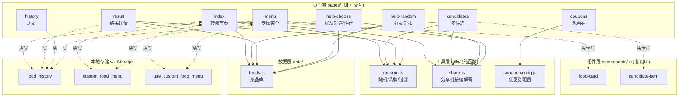
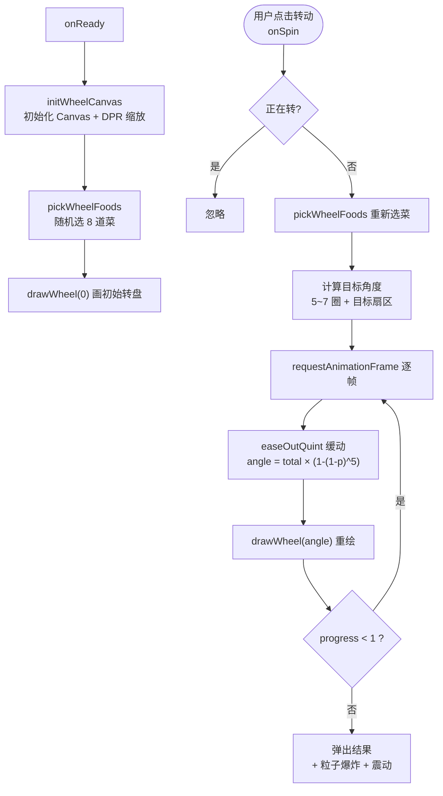
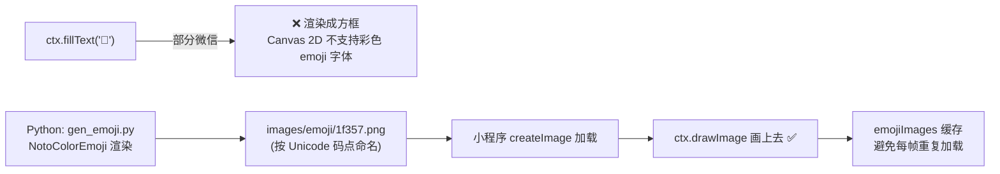
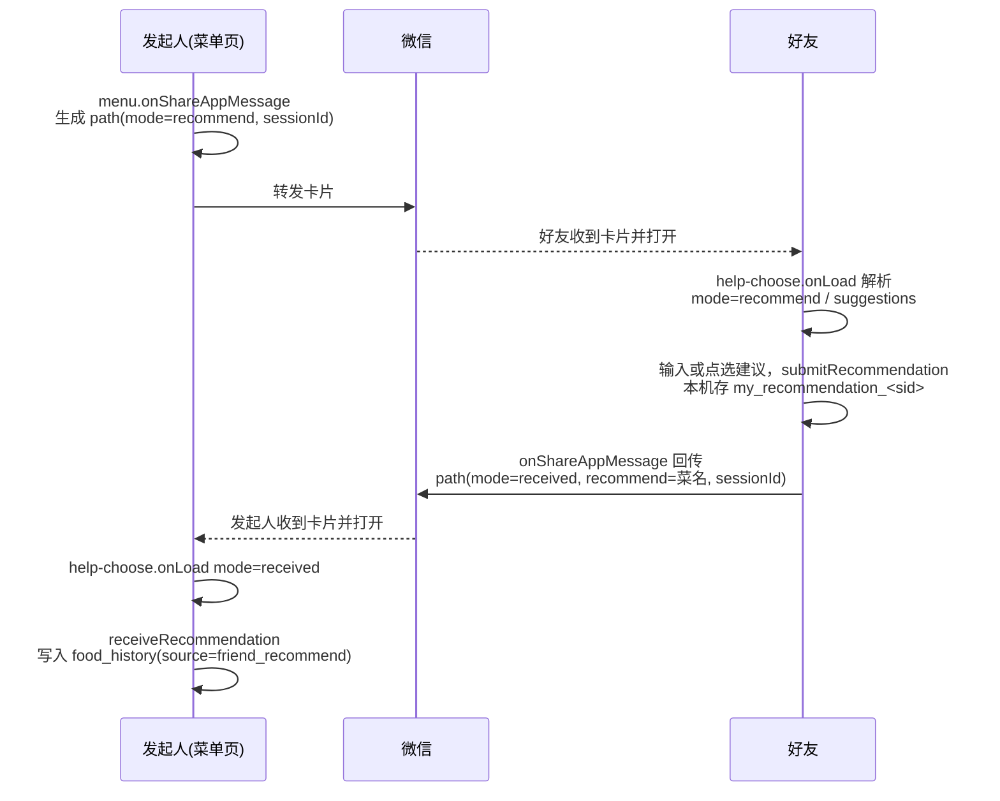
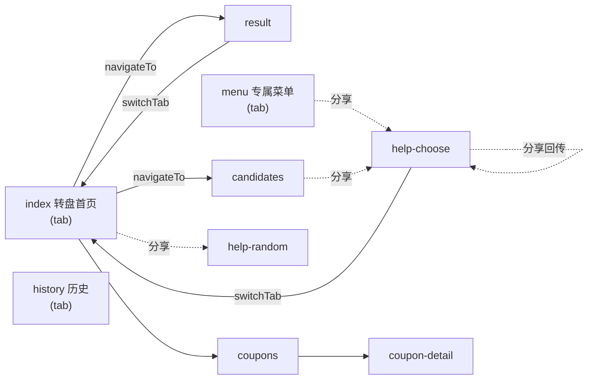

# 「今天吃什么」小程序架构文档

> 面向后续自主开发的项目说明书。含整体设计思路、目录职责、可视化数据流转图、核心机制解析与二次开发指南。
> 图使用 Mermaid 语法，在 VS Code（装 Mermaid 插件）、GitHub、微信开发者工具的 Markdown 预览中均可渲染成可视化图形。

---

## 1. 项目简介

一个帮上班族解决「今天吃什么」选择困难的微信小程序。核心玩法：

- **转盘 / 一键随机**：帮你拍板吃哪道菜。
- **专属菜单**：用户维护自己常吃的菜，转盘只从中抽。
- **社交裂变**：把决策甩给好友——好友帮抽 / 帮选 / 推荐，结果再回传。
- **历史记录**：记录每次吃了什么。
- **外卖优惠券**：变现入口，引导去外卖平台领券。

---

## 2. 技术栈与总体架构

- **框架**：微信小程序原生框架（WXML / WXSS / JS / JSON 四件套），未使用任何第三方框架。
- **语言**：ES5 风格 JavaScript（`var` + `function`，兼容性优先）。
- **无后端**：菜品库写死在 `data/foods.js`，用户数据存本地 `wx.Storage`。
  - ✅ 优点：零服务器成本、可直接发布、无需备案后端。
  - ⚠️ 代价：数据不跨设备同步（换手机数据丢失）。演进方向见 [第 9 节](#9-已知限制与演进方向)。

### 分层架构图



**分层思想**：`data`（数据）→ `utils`（逻辑）→ `components`（UI 块）→ `pages`（组装）。上层依赖下层，下层不反向依赖，这是最值得沿用的工程习惯。

---

## 3. 目录结构与文件职责

```
wechat-miniprogram/
├── app.js              全局入口（onLaunch / globalData）
├── app.json            全局配置：页面路由、导航栏、底部 tabBar
├── app.wxss            全局样式
├── project.config.json 开发者工具配置（AppID 等）
├── sitemap.json        搜索收录配置
│
├── data/
│   └── foods.js        菜品库（60+ 道，id/name/分类/标签/价格/emoji）
│
├── utils/
│   ├── random.js       随机取一/取多(Fisher-Yates洗牌)/过滤/排除
│   ├── share.js        分享路径的拼接与解析（社交闭环核心）
│   └── coupon-config.js 优惠券平台与链接配置
│
├── components/
│   ├── food-card/      菜品卡片组件（properties: food, flipped）
│   └── candidate-item/ 候选项组件
│
├── pages/
│   ├── index/          转盘首页（Canvas 转盘 + 粒子特效，最核心）
│   ├── result/         单个结果详情，确认后写历史
│   ├── candidates/     一次出 4 个候选，可单独替换
│   ├── menu/           专属菜单增删改 + 从历史生成
│   ├── history/        历史记录，按日期分组
│   ├── help-random/    好友打开：帮我随机抽一个
│   ├── help-choose/    好友帮选/推荐（5 种 mode，最复杂）
│   └── coupons/        优惠券列表 + coupon-detail 详情（复制淘口令）
│
└── images/             图标、emoji 预渲染 PNG、小红书配图、生成脚本
```

### 文件职责速查表

| 文件 | 类型 | 一句话职责 |
|------|------|-----------|
| `app.json` | 配置 | 登记所有页面、tabBar、导航栏；**新增页面必须在此登记** |
| `data/foods.js` | 数据 | 菜品库，最常改动 |
| `utils/random.js` | 逻辑 | 随机算法（含 Fisher-Yates 洗牌） |
| `utils/share.js` | 逻辑 | 把状态编码进分享 URL，再从 URL 解码 |
| `pages/index/index.js` | 页面 | Canvas 转盘绘制 + 旋转动画 + 粒子 + emoji 图片 |
| `pages/help-choose/help-choose.js` | 页面 | 一页处理 5 种社交场景（mode 分支） |
| `pages/result/result.js` | 页面 | 确认选择并写入历史 |
| `pages/menu/menu.js` | 页面 | 专属菜单本地增删改 |
| `pages/history/history.js` | 页面 | 读历史、按日期分组展示 |

---

## 4. 核心数据流转图

### 4.1 转盘旋转出结果（index 页）



**要点**：转盘不是图片，是每帧用 Canvas 重画的；动画靠不断改 `currentAngle` 后重绘实现；停止位置由 `targetIndex` 预先算好，动画只是视觉过程。

### 4.2 emoji 为什么要预渲染成 PNG



---

## 5. 社交裂变闭环（help-choose 核心）

小程序**不能主动发消息给指定的人**，只能生成分享卡片让用户手动转发，靠 **URL query 参数**接力传递状态。`sessionId` 把一次「邀请 → 回传」绑定成一轮。

### 5.1 "让好友推荐一道菜"完整时序



### 5.2 help-choose 的 5 种 mode

| mode | 谁打开 | 页面表现 | 关键动作 |
|------|--------|---------|---------|
| `choose` | 好友 | 从发起人给的候选 ids 里选 | `onChoose` 选中，分享回传 |
| `menu` | 好友 | 从发起人菜单 names 里选 | 同上 |
| `recommend` | 好友 | 自由输入推荐，menu 名作为建议 chip | `submitRecommendation` |
| `received` | 发起人 | 展示好友推荐结果 | `receiveRecommendation` 写历史 |
| `received`(本人) | 推荐人自己 | 只展示"我推荐了啥"，不写历史 | `showAuthorView` |

**身份区分技巧**：推荐人在 `submitRecommendation` 时用 `wx.setStorageSync('my_recommendation_' + sessionId, name)` 打标记；之后任何人打开 `received` 卡片，先查这个标记——有标记 = 推荐人本人（走 `showAuthorView` 不写历史），无标记 = 真正的发起人（走 `receiveRecommendation` 写历史）。避免"自己收到自己的推荐"污染历史。

---

## 6. 本地存储数据模型

全项目仅 3 个 Storage key + 若干 session 临时标记：

| key | 类型 | 内容 | 写入方 | 读取方 |
|-----|------|------|--------|--------|
| `food_history` | Array | 历史记录（最多 50 条） | result / help-choose | history / menu |
| `custom_food_menu` | Array\<string\> | 专属菜单菜名 | menu | index / menu |
| `use_custom_food_menu` | Boolean | 是否启用专属菜单 | menu | index / menu |
| `my_recommendation_<sid>` | string | 推荐人本机标记 | help-choose | help-choose |
| `received_recommendation_<sid>` | Boolean | 防重复入历史 | help-choose | help-choose |

**历史记录条目结构**：
```js
{
  foodId: 1,               // 库内菜有；好友推荐的自定义菜可能无
  foodName: "黄焖鸡米饭",
  emoji: "🍗",
  timestamp: 1719100000000,
  source: "self",          // self/custom/friend_random/friend_choose/friend_recommend
  fromName: "小明"          // 仅好友相关来源有
}
```

⚠️ **存储范围**：数据 = 绑定【小程序】+【微信号】+【设备】三者。换手机 = 数据丢失（不跟微信号走）。单设备上限 10MB。

---

## 7. 页面路由与跳转关系



**跳转 API 区分**（易错点）：
- **tab 页之间**（index / menu / history）必须用 `wx.switchTab`。
- **非 tab 页**用 `wx.navigateTo`（压栈，可返回）、`wx.navigateBack`（返回）。
- 分享出去的页面（help-random / help-choose）由微信卡片打开，不走上述 API。

---

## 8. 核心机制解析

### 8.1 Canvas 转盘（index.js）
- 用 `wx.createSelectorQuery().select('#wheelCanvas').fields({node:true,size:true})` 拿新版 Canvas 2D 节点。
- 按 `pixelRatio`（DPR）放大画布再 `ctx.scale`，保证高清不糊。
- `drawWheel(angle)`：`ctx.translate` 到圆心 → `ctx.rotate(angle)` → 循环画 8 个扇形（`ctx.arc`）+ 菜名文字 + emoji 图片。
- `onSpin`：`requestAnimationFrame` 逐帧，`easeOutQuint`（`1-(1-p)^5`）做"先快后慢"减速，转 5~7 圈后停在预先随机的 `targetIndex`。

### 8.2 emoji 预渲染（见 4.2 图）
Canvas 2D 不支持彩色 emoji 字体，`fillText` 出方框。解决：`images/gen_emoji.py` 用 Pillow + NotoColorEmoji 把 emoji 渲染成 PNG（按 Unicode 码点 hex 命名），运行时 `createImage` + `drawImage`，`emojiImages` 缓存。

### 8.3 专属菜单智能 emoji（index.js `guessEmoji`）
用户自定义菜没 emoji，`guessEmoji(name)` 三级匹配：① 默认库精确匹配 → ② `EMOJI_RULES` 关键词匹配（顺序敏感，具体词在前）→ ③ 兜底 `🍽️`。

### 8.4 分享参数编解码（share.js）
所有 `buildXxxSharePath()` 就是拼接带 query 的路径，目标页 `onLoad(options)` 解析。中文用 `encodeURIComponent` 编码，`ids` 用逗号连接、`names` 用 `|` 连接。

---

## 9. 已知限制与演进方向

| 限制 | 现状 | 演进方案 |
|------|------|---------|
| 数据不跨设备 | 本地 Storage | **微信云开发**（云数据库按 openid 存），改造成本低 |
| 菜品库写死 | `data/foods.js` | 迁到云数据库，支持后台配菜 |
| 搜索曝光低 | 个人主体未认证 | 企业认证 + 配置关键词 |
| 存储调用分散 | 各页面直接调 `wx.Storage` | 收拢到 `utils/storage.js`，便于将来切云 |

**推荐的第一步重构**：新建 `utils/storage.js` 封装 `getHistory / addHistory / getMenu / setMenu`，页面不再直接调 `wx.setStorageSync`。将来切换云开发时只改这一个文件。

---

## 10. 二次开发上手路径（由易到难）

1. **改数据**：`data/foods.js` 加菜、换 emoji —— 熟悉数据驱动视图。
2. **改文案/样式**：改页面 `.wxml` 文字、`.wxss` 颜色 —— 熟悉四件套联动。
3. **加简单功能**：给结果页加"按价格筛选"，复用 `utils/random.js` 的 `filterFoods`。
4. **加新页面**：新建 `pages/xxx/` 四件套 → 在 `app.json` 的 `pages` 登记。
5. **啃转盘**：调 `WHEEL_SLOTS` / `WHEEL_COLORS` / 动画曲线，理解 Canvas 逐帧绘制。

**必读官方文档**：小程序框架（Page / Component 生命周期）、`wx.Storage` / `wx.navigateTo` / `wx.switchTab` API、Canvas 2D 接口、`onShareAppMessage`。

---

_本文档随代码演进，改动核心机制时请同步更新对应图与说明。_
