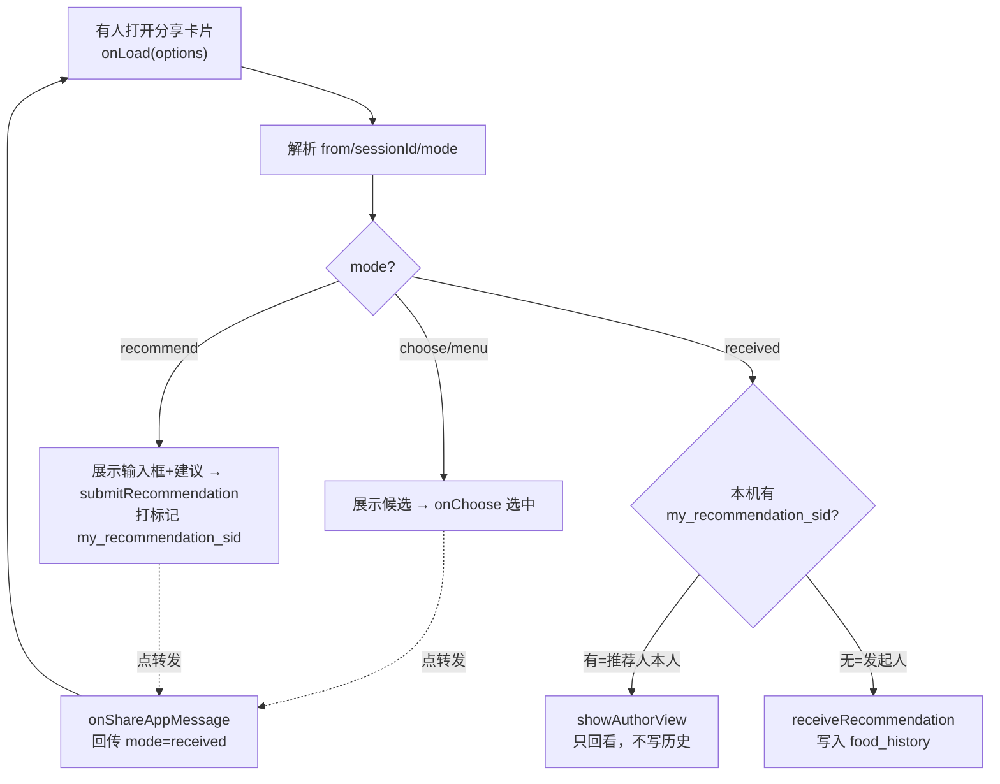

# help-choose.js 逐行详解

> 这是全项目逻辑最复杂的页面：**一个页面用 `mode` 参数处理 5 种社交场景**。
> 建议对照源码 `pages/help-choose/help-choose.js` 一起看。行号以当前源码为准。
> 若不熟悉整体社交闭环，先看 [ARCHITECTURE.md](./ARCHITECTURE.md) 第 5 节。

---

## 全局认知：这个页面在整个闭环里的位置

同一份 `help-choose.js` 会被**不同的人、在不同阶段**打开，靠分享 URL 里的 `mode` 区分身份：

| 打开者 | mode | 在做什么 |
|--------|------|---------|
| 好友 | `choose` / `menu` | 从我给的候选里帮我选 |
| 好友 | `recommend` | 自由帮我推荐一道 |
| 发起人（我） | `received` | 查看好友推荐的结果，并写入我的历史 |
| 推荐人自己 | `received` | 只回看"我推荐了啥"，**不**写历史 |

---

## 顶部：依赖与辅助函数

```js
var foodsData = require('../../data/foods.js');   // 菜品库
var shareUtil = require('../../utils/share.js');  // 分享路径编解码
```
引入数据层和工具层。ES5 的 `require` 模块写法。

```js
function createSessionId() {
  return Date.now().toString(36) + '_' + Math.random().toString(36).substring(2, 10);
}
```
**生成一次会话的唯一 ID**。`Date.now().toString(36)` 把时间戳转 36 进制（更短），加随机串防碰撞。`sessionId` 的作用：把「A 发起邀请」和「B 回传结果」绑定成同一轮，避免多轮邀请互相串数据。

```js
function getFoodByName(name) {
  return foodsData.foods.find(function(food) {
    return food.name === name;
  });
}
```
**按菜名在默认库里查菜**。好友推荐的可能是库里的菜（能查到完整信息），也可能是自定义菜（查不到，后面用兜底对象）。

---

## data：页面状态

```js
data: {
  fromName: '好友',        // 分享者昵称（从 URL 解析）
  candidates: [],          // 候选菜列表（choose/menu 模式用）
  chosen: null,            // 已选中的候选 id
  chosenFood: null,        // 已选中的候选完整对象
  mode: 'choose',          // 当前场景，决定页面显示哪块 UI
  recommendationInput: '', // 推荐输入框的内容
  submitted: false,        // 是否已提交推荐（控制"已选好"状态）
  sessionId: '',           // 会话 ID
  receivedFood: {},        // received 模式：收到的推荐菜
  suggestions: [],         // recommend 模式：菜单名作为快捷建议 chip
  isAuthor: false          // received 模式：打开者是不是推荐人本人
}
```
WXML 靠这些字段用 `{{mode}}`、`wx:if` 决定渲染哪一块面板。**读懂 data 就读懂了页面有哪些状态。**

---

## onLoad：入口分发（最关键）

好友/发起人打开分享卡片时，微信把 URL 的 query 传进 `options`。这段代码负责**解析参数 + 按 mode 分流**。

```js
onLoad: function(options) {
  var fromName = options.from ? decodeURIComponent(options.from) : '好友';
  var sessionId = options.sessionId ? decodeURIComponent(options.sessionId) : '';
  this.setData({ fromName: fromName, sessionId: sessionId });
```
先取出分享者昵称和会话 ID。中文经过 `encodeURIComponent` 编码，这里要 `decodeURIComponent` 解码。

```js
  var mode = options.mode || 'choose';
  var data = { mode: mode };
```
取 mode，默认 `choose`。用一个 `data` 累积要 setData 的字段，最后一次性设置（减少渲染次数）。

```js
  if (options.ids) {
    var ids = shareUtil.parseIds(options.ids);
    data.candidates = shareUtil.getFoodsByIds(foodsData.foods, ids);
  }
```
**choose 模式**：URL 带 `ids=1,2,3`，用 `parseIds` 解析成数组，再从库里取出完整菜品对象作为候选。

```js
  if (options.names) {
    var nameList = decodeURIComponent(options.names).split('|').filter(function(name) {
      return name;
    });
    if (mode === 'recommend') {
      data.suggestions = nameList;              // recommend：菜单名只当建议 chip
    } else {
      data.candidates = nameList.map(function(name, index) {
        return {
          id: 'shared_' + index,
          name: name,
          categoryName: '好友推荐菜单',
          priceRange: '自定',
          emoji: '🍽️',
          description: '好友邀请你从专属菜单中选择的美食。'
        };
      });                                       // menu：菜单名当候选列表
    }
  }
```
**names 参数一名两用**：
- `recommend` 模式 → 菜单名只作为输入框上方的**快捷建议**（点一下填进输入框）。
- `menu` 模式 → 菜单名变成**候选卡片**供选择（这里给自定义菜造了个临时对象，emoji 先兜底 `🍽️`）。

```js
  if (options.recommend) {
    data.recommendationInput = decodeURIComponent(options.recommend);
  }
```
**received 模式**：URL 带 `recommend=菜名`，就是好友推荐的结果，先存进输入框字段。

```js
  if ((mode === 'menu' || mode === 'recommend') && !sessionId) {
    sessionId = createSessionId();
    data.sessionId = sessionId;
  }
  this.setData(data);
```
menu/recommend 是"发起邀请"的场景，若还没 sessionId 就新建一个。然后一次性 setData。

```js
  if (mode === 'received' && data.recommendationInput) {
    var sid = this.data.sessionId;
    var iRecommended = sid ? wx.getStorageSync('my_recommendation_' + sid) : '';
    if (iRecommended) {
      this.showAuthorView(data.recommendationInput);   // 我就是推荐人 → 只回看
    } else {
      this.receiveRecommendation(data.recommendationInput, fromName); // 我是发起人 → 收下并写历史
    }
  }
}
```
**身份判定的精髓**：received 卡片可能被两种人打开——
- **推荐人自己**：他之前推荐时在本机存过 `my_recommendation_<sid>`，查得到 → `showAuthorView`，只展示不写历史（否则自己会收到自己的推荐）。
- **真正的发起人**：本机没这个标记 → `receiveRecommendation`，收下并写入历史。

---

## 推荐输入相关

```js
onRecommendationInput: function(e) {
  this.setData({ recommendationInput: e.detail.value, submitted: false });
}
```
输入框内容变化时同步到 data，并重置"已提交"状态（改动了就得重新提交）。

```js
onPickSuggestion: function(e) {
  var name = e.currentTarget.dataset.name;
  this.setData({ recommendationInput: name, submitted: false });
}
```
点击建议 chip（`data-name`），把该菜名快速填进输入框。`e.currentTarget.dataset.xxx` 是读 WXML 上 `data-xxx` 的标准方式。

```js
submitRecommendation: function() {
  var name = (this.data.recommendationInput || '').trim();
  if (!name) return;                                   // 空的不提交
  var sid = this.data.sessionId;
  if (sid) {
    wx.setStorageSync('my_recommendation_' + sid, name); // 打"我是推荐人"标记
  }
  this.setData({ submitted: true, recommendationInput: name });
  wx.showToast({ title: '选好啦！记得发回给TA', icon: 'none' });
}
```
好友提交推荐：**关键是打本机标记** `my_recommendation_<sid>`，这是后续身份判定的依据。然后提示"记得发回给 TA"（引导转发回传）。

```js
redoRecommendation: function() {
  this.setData({ submitted: false });   // 回到可编辑状态，重新选
}
```

---

## 解析与展示

```js
resolveFood: function(name) {
  return getFoodByName(name) || {
    name: name,
    emoji: '🍽️',
    categoryName: '好友推荐',
    priceRange: '自定',
    description: '这是好友为你推荐的美食，快去尝尝吧！'
  };
}
```
按菜名解析：库里有就用库里的完整信息；没有（自定义菜）就造一个兜底对象。

```js
showAuthorView: function(name) {
  var food = this.resolveFood(name);
  this.setData({ receivedFood: food, isAuthor: true });
}
```
**推荐人本人**打开回传卡片：只把菜显示出来（`isAuthor: true` 让 WXML 显示"你推荐了 XX"这类文案），**不写历史**。

```js
receiveRecommendation: function(name, fromName) {
  var food = this.resolveFood(name);
  this.setData({ receivedFood: food, isAuthor: false });

  var sessionId = this.data.sessionId || 'legacy';
  var receiveKey = 'received_recommendation_' + sessionId;
  if (wx.getStorageSync(receiveKey)) return;   // 已收过，防重复入历史
  wx.setStorageSync(receiveKey, true);

  var timestamp = Date.now();
  var history = wx.getStorageSync('food_history') || [];
  history.unshift({                            // 新记录插到最前
    foodName: food.name,
    emoji: food.emoji,
    timestamp: timestamp,
    source: 'friend_recommend',
    fromName: fromName
  });
  if (history.length > 50) history = history.slice(0, 50); // 最多留 50 条
  wx.setStorageSync('food_history', history);

  wx.showModal({
    title: '收到好友推荐',
    content: fromName + '已完成推荐，推荐了“' + name + '”。已将它加入历史记录。',
    showCancel: false,
    confirmText: '知道了'
  });
}
```
**发起人收下推荐**：
1. `received_recommendation_<sid>` 防重复——同一条推荐多次打开不会重复入历史。
2. `history.unshift(...)` 把新记录插到数组最前（最新在上）。
3. `slice(0, 50)` 限制历史长度。
4. 弹窗告知。

---

## onChoose：候选里选中

```js
onChoose: function(e) {
  var id = e.currentTarget.dataset.id;
  var food = this.data.candidates.find(function(f) {
    return f.id === id;
  });
  this.setData({
    chosen: id,
    chosenFood: food,
    recommendationInput: food ? food.name : ''
  });
}
```
choose/menu 模式点选某个候选卡片：记录选中 id 和对象，并把菜名填进 `recommendationInput`（供后续分享回传用）。

```js
goToIndex: function() {
  wx.switchTab({ url: '/pages/index/index' });  // 回首页（tab 页用 switchTab）
}
```

---

## onShareAppMessage：按 mode 决定"回传/继续转发"什么

这是页面的另一半灵魂——**用户点转发时**，根据当前 mode 生成不同的分享卡片。

```js
onShareAppMessage: function() {
  var mode = this.data.mode;
  var selectedFood = this.data.chosenFood;
```

```js
  // received：把好友推荐结果继续往下传（比如再转给别人看）
  if (mode === 'received') {
    var recvName = this.data.receivedFood.name;
    return {
      title: '😋 有人安利了「' + recvName + '」，你也来尝尝！',
      path: shareUtil.buildRecommendationSharePath(recvName, this.data.fromName, this.data.sessionId)
    };
  }
```

```js
  // recommend：好友自由推荐后，把结果回传给发起人
  if (mode === 'recommend') {
    var recName = (this.data.recommendationInput || '').trim();
    return {
      title: recName ? '😋 我给你安利了「' + recName + '」，快去吃！'
                     : '🍜 选择困难求助：帮我推荐一道好吃的呗！',
      path: recName
        ? shareUtil.buildRecommendationSharePath(recName, this.data.fromName, this.data.sessionId)
        : shareUtil.buildRecommendSharePath(this.data.suggestions, this.data.sessionId)
    };
  }
```
**有没有填推荐**决定两种卡片：填了 → 回传结果（mode=received）；没填 → 继续当邀请转发。

```js
  // choose/menu：从候选里选中后，回传推荐结果给发起人
  if (selectedFood) {
    return {
      title: '✅ 帮你拍板了：' + selectedFood.name + '，就它！',
      path: shareUtil.buildRecommendationSharePath(selectedFood.name, this.data.fromName, this.data.sessionId)
    };
  }
```

```js
  // 兜底：还没选中，就继续作为"帮我选"邀请转发
  return {
    title: '🆘 选择困难求助：帮我从这几个里挑一个！',
    path: shareUtil.buildMenuSharePath(
      this.data.candidates.map(function(food) { return food.name; }),
      '好友', this.data.sessionId)
  };
}
```

---

## 一图串起来



---

## 阅读这段代码的三个收获

1. **一页多态**：用一个 `mode` 参数复用同一页面处理多角色多场景，比拆成 5 个页面更省事——但要靠 data 字段和 `wx:if` 把 UI 分清楚。
2. **无后端做社交**：状态全靠 URL 参数 + 本地标记接力，`sessionId` 是绑定一轮的关键。
3. **防错细节**：`received_recommendation_<sid>` 防重复入历史、`my_recommendation_<sid>` 防自己收到自己——这类"边界处理"才是真实项目和 demo 的区别。
