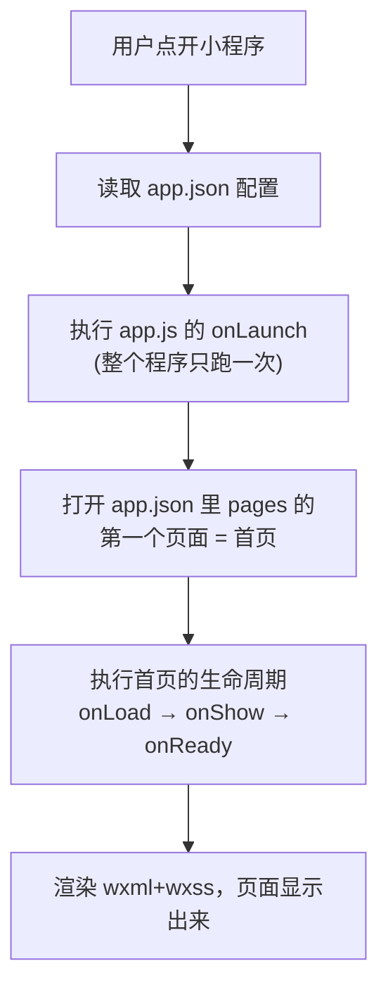
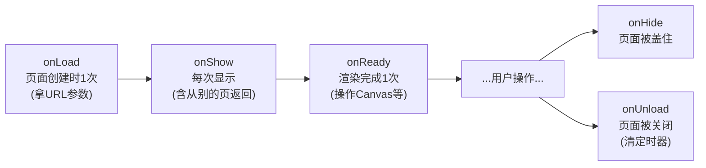
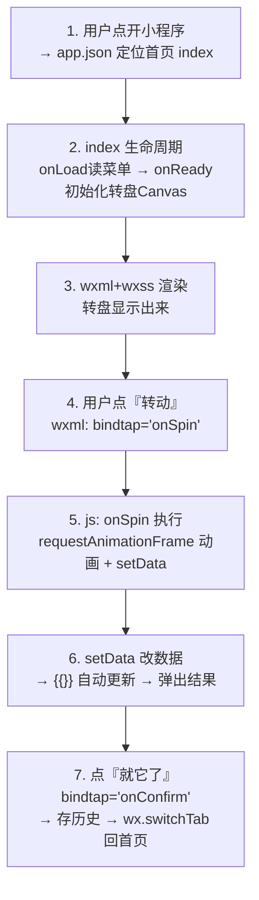

# 小程序基础：从"打开"到"页面显示、操作、跳转"（零基础版）

> 用本项目真实代码，把小程序运行的最基础流程讲透。看完你就能看懂任意一个页面是怎么跑起来的。
> 配套：整体架构看 [ARCHITECTURE.md](../ARCHITECTURE.md)。

---

## 0. 先记住一句话

> **小程序 = 一堆"页面"，每个页面由 4 个文件组成，微信按你写的配置把它们组装起来显示，用户点一下就触发你写的 JS 函数。**

不用背，下面一步步拆。

---

## 1. 四件套：一个页面的"身体结构"

打开 `pages/index/` 文件夹，你会看到 4 个同名文件：

| 文件 | 类比 | 管什么 | 例子 |
|------|------|--------|------|
| `index.wxml` | 骨架（HTML） | 页面**长什么样**、有哪些元素 | 一个按钮、一段文字 |
| `index.wxss` | 皮肤（CSS） | 元素的**样式** | 按钮是蓝色、圆角 |
| `index.js` | 大脑（逻辑） | **数据**和**点击后做什么** | 点按钮 → 随机选菜 |
| `index.json` | 身份证（配置） | 这个页面的**局部配置** | 用了哪些组件、标题 |

**微信靠"同名"自动把这 4 个文件关联成一个页面**，你不用手动引入。这就是为什么它们必须同名（都叫 `index`）。

---

## 2. 打开小程序：从点击图标到看见首页

用户在微信里点开你的小程序，微信内部按这个顺序执行：



### 关键角色：`app.json`（全局总配置）
它决定了"程序打开先看到谁"。看你项目的 `app.json`：

```json
{
  "pages": [
    "pages/index/index",     ← 数组第一个，就是打开时的首页
    "pages/result/result",
    ...
  ],
  "tabBar": { ... }          ← 底部三个 tab 导航
}
```

**两条铁律**（新手最常踩坑）：
1. **任何页面都必须在 `pages` 数组里登记**，否则跳过去会报错"page not found"。
2. **数组第一个 = 启动首页**。想换首页，把它挪到第一位。

### `app.js`（全局入口）
```js
App({
  onLaunch: function() {
    // 小程序启动时执行一次，整个生命周期只跑一次
  },
  globalData: { userInfo: null }  // 想跨页面共享的数据放这
})
```
它用 `App({...})` 定义（注意大写 A），**整个程序只有一个**。页面则用 `Page({...})`。

---

## 3. 页面是怎么"显示"出来的：数据驱动视图

这是小程序**最核心的思想**，务必理解。

### 传统网页：手动改页面
```js
document.getElementById('x').innerText = '你好';  // 直接操作页面元素
```

### 小程序：改数据，页面自动变
你**永远不直接操作页面元素**，而是：
1. 在 `.js` 的 `data` 里放数据；
2. 在 `.wxml` 里用 `{{ }}` 把数据"挖个坑"显示出来；
3. 想改显示时，调 `this.setData(...)` 改数据，**页面自动刷新**。

### 用真实代码看（result 页）

`.js` 里定义数据：
```js
Page({
  data: {
    food: {}     // 一开始是空对象
  },
  onLoad: function(options) {
    // ...找到菜后：
    this.setData({ food: food });  // 把数据塞进去
  }
})
```

`.wxml` 里挖坑显示：
```xml
<view>{{food.name}}</view>     <!-- 显示菜名 -->
<view>{{food.emoji}}</view>    <!-- 显示 emoji -->
```

**流程**：`onLoad` 里 `setData({food})` → WXML 的 `{{food.name}}` 自动变成"黄焖鸡米饭"。你没碰任何页面元素，它自己更新了。

> 🔑 记住：**看到 `{{xxx}}` 就去 `.js` 的 `data` 里找 `xxx`；想让页面变，就 `setData`。**

### 条件显示与列表

**条件**（`wx:if`）——满足才显示：
```xml
<view wx:if="{{showResult}}">结果出来啦</view>
```
`showResult` 为 `true` 才显示这块。你项目里转盘出结果的弹窗就是这么控制的。

**列表**（`wx:for`）——循环显示一组：
```xml
<view wx:for="{{candidates}}" wx:key="id">
  {{item.name}}    <!-- item 是数组里的每一项 -->
</view>
```
candidates 有 4 道菜，就显示 4 行。这是 candidates 页展示候选的方式。

---

## 4. 生命周期：页面"出生到消失"会自动调用的函数

页面显示/隐藏时，微信会**自动**帮你调用几个特定名字的函数（钩子）。你把代码写进去，它就会在对应时机执行。



| 钩子 | 什么时候触发 | 一般用来做 | 本项目例子 |
|------|-------------|-----------|-----------|
| `onLoad(options)` | 页面**创建时一次** | **接收跳转/分享传来的参数** | help-choose 用它解析 `mode`、`ids` |
| `onShow` | **每次**显示（包括从别页返回） | 刷新可能变化的数据 | index 每次显示重新读专属菜单 |
| `onReady` | 首次渲染完成一次 | 操作 Canvas（这时元素才就绪） | index 初始化转盘画布 |
| `onUnload` | 页面关闭 | 清理定时器等 | index 清掉灯光闪烁定时器 |

**新手最重要的两个**：
- **`onLoad(options)`**：`options` 就是别人跳转/分享给你的参数（URL 里 `?a=1&b=2` 的部分）。
- **`onShow`**：从别的页面返回时会再次触发（`onLoad` 不会），需要"每次都刷新"的放这里。

### 真实例子：result 页用 onLoad 拿参数
```js
onLoad: function(options) {
  if (options.id) {                     // 别的页面跳过来时带了 ?id=1
    var id = parseInt(options.id, 10);
    var food = foodsData.foods.find(f => f.id === id);
    if (food) this.setData({ food: food });  // 找到菜并显示
  }
}
```

---

## 5. 用户操作：点一下怎么触发你的代码

### 第一步：在 WXML 上"绑定"事件
用 `bindtap`（tap = 点击）把某个元素和 JS 里的函数名绑起来：
```xml
<button bindtap="onConfirm">🔥 就它了</button>
```
意思：**点这个按钮 → 执行 js 里叫 `onConfirm` 的函数**。

### 第二步：在 JS 里写这个函数
```js
Page({
  onConfirm: function() {
    // 用户点了按钮，这里的代码就会执行
    wx.showToast({ title: '就这么定了！' });
  }
})
```

### 常见的绑定
| WXML 写法 | 触发时机 |
|-----------|---------|
| `bindtap="fn"` | 点击 |
| `bindinput="fn"` | 输入框内容变化 |
| `bindchange="fn"` | 开关/选择器改变 |
| `open-type="share"` | 特殊：点了触发转发（不用写函数） |

### 第三步：怎么知道"点的是哪一个"？用 `data-xxx`
列表里有 4 个候选，点其中一个，怎么知道点的是第几个？在元素上挂 `data-`：
```xml
<view wx:for="{{candidates}}" wx:key="id"
      bindtap="onChoose" data-id="{{item.id}}">
  {{item.name}}
</view>
```
JS 里通过 `e.currentTarget.dataset` 读出来：
```js
onChoose: function(e) {
  var id = e.currentTarget.dataset.id;   // 拿到被点那项的 id
  // ...
}
```
> 🔑 `e` 是事件对象，`e.currentTarget.dataset.xxx` 对应 WXML 上的 `data-xxx`。这是"点了哪个"的标准取法。

### 输入框例子（menu 页添加菜）
```xml
<input bindinput="onMenuInput" value="{{menuInput}}"/>
<button bindtap="addMenuItem">添加</button>
```
```js
onMenuInput: function(e) {
  this.setData({ menuInput: e.detail.value });  // 每次输入同步到 data
},
addMenuItem: function() {
  var name = this.data.menuInput;               // 读出输入内容
  // ...加到菜单
}
```
注意：输入框内容变化用 `e.detail.value` 取（不是 dataset）。

---

## 6. 页面跳转：从一个页面到另一个页面

### 4 个跳转 API（务必分清，新手高频踩坑）

```mermaid
flowchart TD
  subgraph 普通页面(可返回)
    a["A页"] -->|"wx.navigateTo<br/>压栈,能返回"| b["B页"]
    b -->|"wx.navigateBack<br/>返回上一页"| a
  end
  subgraph tab页(底部导航那几个)
    t1["index"] -->|"wx.switchTab<br/>切tab专用"| t2["menu"]
  end
```

| API | 用途 | 能否返回 | 限制 |
|-----|------|---------|------|
| `wx.navigateTo` | 打开新页面 | ✅ 能返回 | **不能跳 tab 页** |
| `wx.navigateBack` | 返回上一页 | — | — |
| `wx.switchTab` | 切到 tab 页 | ❌ | **只能跳 tab 页**（index/menu/history） |
| `wx.redirectTo` | 替换当前页 | ❌ 关掉当前 | 不能跳 tab |

> 🔑 **铁律**：跳到底部导航的三个页面（吃什么/专属菜单/历史）必须用 `wx.switchTab`；跳其它页面用 `wx.navigateTo`。用错会静默失败或报错。

### 跳转时怎么"传参数"给下一个页面？
在 URL 后面拼 `?键=值&键=值`，下个页面 `onLoad(options)` 里接收：

**发送方**（比如从首页跳到结果页）：
```js
wx.navigateTo({
  url: '/pages/result/result?id=1'   // 传了 id=1
})
```

**接收方**（result 页 onLoad）：
```js
onLoad: function(options) {
  var id = options.id;   // 收到 "1"
}
```

### 真实例子：result 确认后跳回首页
```js
onConfirm: function() {
  // ...存历史...
  setTimeout(function() {
    wx.switchTab({ url: '/pages/index/index' });  // 首页是tab页，用switchTab
  }, 1500);
}
```

### 特殊跳转：通过"分享卡片"打开
好友点你转发的卡片打开某页，这不走上面的 API，而是靠 `onShareAppMessage` 里配置的 `path`：
```js
onShareAppMessage: function() {
  return {
    title: '帮我抽一个今天吃啥',
    path: '/pages/help-random/help-random?from=小明'  // 好友打开这个路径
  }
}
```
好友打开时，`help-random` 的 `onLoad(options)` 就能拿到 `options.from = '小明'`。**这就是社交功能的底层原理**（详见架构文档第 5 节）。

---

## 7. 完整走一遍：以"转盘选菜"为例串起全流程

把前面所有知识点连起来，看一次真实交互：



对应文件：
1. `app.json` 决定首页
2. `index.js` 的 `onLoad`/`onReady`
3. `index.wxml` + `index.wxss`
4. `index.wxml` 里 `bindtap="onSpin"`
5. `index.js` 里 `onSpin` 函数
6. `setData` → WXML `{{}}`
7. `wx.switchTab` 跳转

---

## 8. 新手最容易搞混的 5 件事（避坑清单）

1. **改页面 ≠ 直接改元素**：永远通过 `setData` 改 `data`，不要想着操作 DOM。
2. **`onLoad` vs `onShow`**：只在打开时执行一次的用 `onLoad`；每次进入都要刷新的用 `onShow`。
3. **`switchTab` vs `navigateTo`**：跳 tab 页只能用 `switchTab`，别搞反。
4. **新页面要登记**：新建页面必须加进 `app.json` 的 `pages`。
5. **取值来源不同**：点击项用 `e.currentTarget.dataset.xxx`；输入框用 `e.detail.value`。

---

## 9. 建议的动手练习

1. 打开 `pages/result/result.wxml`，把某段文字改一下，编译看变化 —— 体会 wxml。
2. 在 `result.js` 的 `onConfirm` 里加一行 `console.log('点了确认')`，点按钮后在调试器 Console 看输出 —— 体会事件。
3. 给 result 页加个"返回首页"按钮：wxml 写 `<button bindtap="goHome">`，js 写 `goHome(){ wx.switchTab({url:'/pages/index/index'}) }` —— 体会跳转。

跑通这三个，你就掌握了小程序开发的 80% 日常操作。

---

_本文是零基础入门。深入机制（Canvas、社交闭环）见 ARCHITECTURE.md 与 docs/help-choose-逐行详解.md。_
